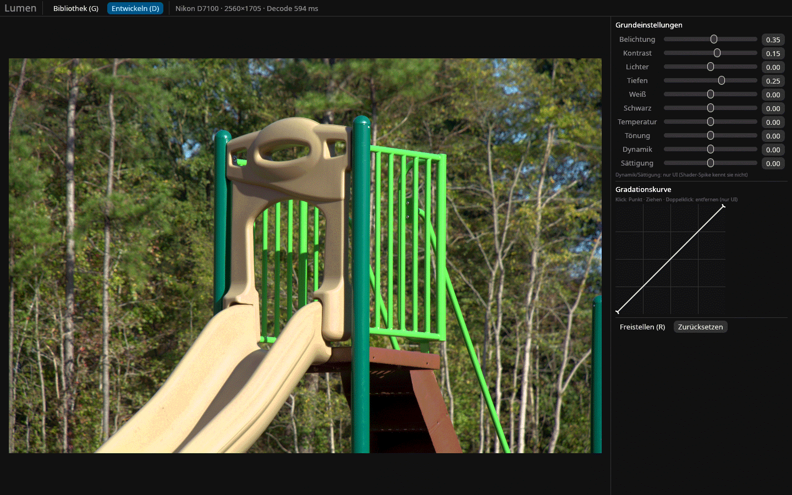

# Lumen · light

> Schneller, freier RAW-Entwickler für **Linux und Windows** – eine abofreie
> Lightroom-Alternative als native Desktop-App in Rust. Kein Konto, keine Cloud,
> Originale bleiben unangetastet.

[](LICENSE)




## Warum

Lumen startete als Browser-Editor. RAW-Dateien mit 25–60 MB in den Browser zu
laden war zu langsam. Lumen wird deshalb als **native App** neu gebaut:
egui für die Oberfläche, wgpu für die Bildpipeline auf der GPU, LibRaw für das
Dekodieren. Der Web-Editor wird abgelöst.

**Ziele:**

- Sehr flüssig unter Linux: ein Regler-Zug ist in einem Frame auf dem Schirm.
- Lokale Bibliothek mit Raster, Lupe, Sternen, Farblabels und Filtern.
- Nicht-destruktiv: Edits liegen neben dem Original, das RAW wird nie geschrieben.
- Kein Konto nötig. Netzwerk nur, wenn du es auslöst (Marketplace, Teilen, Update-Check).
- Erweiterbar über Plugins aus der Community (in Planung).

## Stand

| Phase | Inhalt | Stand |
|---|---|---|
| N0 | Spike: Decode, GPU-Pipeline, egui-Prototyp, Windows-Build, Goldens | fertig |
| N1 | `lumen-core`: reine Module, Referenzvektoren | als Nächstes |
| N2–N8 | Decode-Stufen, Editor, Masken, Bibliothek, Lupe, Export | geplant |
| N9–N10 | Marketplace-Anbindung, Paketierung, Download | geplant |

Details: [Design](docs/superpowers/specs/2026-11-27-desktop-native-rust-design.md) ·
[Spike-Ergebnis N0](docs/superpowers/specs/2026-11-27-n0-spike-results.md) ·
[Roadmap](docs/06-roadmap.md)

### Messwerte aus dem Spike

Nikon Z6III, 24,5 MP NEF, Ryzen 7 7735HS / Radeon 680M, Datei im Cache:

| Schritt | Zeit |
|---|---|
| Eingebettete Vorschau | 4 ms |
| Bearbeitbar (`half_size`) | 414 ms |
| Voller Decode (LibRaw mit OpenMP) | 889 ms |
| Regler bis Bild (GPU-Rechenzeit) | 1,2 ms |

Der Look entspricht dem bisherigen Web-Renderer: höchstens 1/255 Abweichung auf
Vulkan (radv, anv, lavapipe) und DX12, mittleres ΔE2000 ≤ 0,08.

## Bauen

Voraussetzungen: Rust über `rustup` (die Version pinnt `desktop/rust-toolchain.toml`),
ein C++-Compiler und libclang für bindgen (Ubuntu: `clang libclang-dev
libclang-common-21-dev`).

```bash
git clone https://github.com/phash/lumen-light.git
cd lumen-light
git submodule update --init          # LibRaw-Quellen

cd desktop
cargo build --release
cargo build --release -p lumen-bench --features openmp   # LibRaw parallel (Linux)

# Prototyp starten (Wegwerf-UI aus Spike N0), aus der Repo-Wurzel
cd .. && cargo run --release --manifest-path desktop/spikes/ui-proto/Cargo.toml -- \
  tests-fixtures/raw-samples/Nikon_D7100.NEF
```

Windows-Build aus Linux: `desktop/scripts/build-windows.sh` (cargo-xwin, clang-cl).

## Tests

```bash
bash scripts/fetch-test-images.sh    # RAW-Testkorpus laden (sha256-geprüft)
make -C desktop ci                   # fmt, clippy -D warnings, Tests
./ci.sh                              # alles: Desktop + Frontend + Backend
```

- **Goldens:** `tests-fixtures/goldens/` sind Referenzbilder aus dem WebGL-Renderer
  (`cd frontend && pnpm golden`). Toleranz 2/255 pro Kanal.
- **ΔE-Prüfung umschaltbar:** `LUMEN_DE_MODE=mean|pixel|off`, Grenze über `LUMEN_DE_MAX`
  (Default 1,0, Mittelwert pro Bild).
- **Fixtures Pflicht:** mit `LUMEN_REQUIRE_FIXTURES=1` schlagen Tests fehl statt zu überspringen.
- **Plugin-Manifest-Schema** neu erzeugen: `LUMEN_BLESS=1 cargo test -p lumen-plugin-manifest --test schema`
  (schreibt `schemas/lumen-plugin.schema.json`, CI vergleicht).
- **Benchmark:** `lumen-bench --runs 5 --out bench.json <RAW-Dateien>`.

## Aufbau

```
desktop/
  crates/libraw-sys   LibRaw 0.22.3 statisch, bindgen (Feature `openmp`)
  crates/lumen-raw    Decode in Stufen: Vorschau → half_size → voll
  crates/lumen-gpu    wgpu-Pipeline, WGSL-Port der Tonstufen
  tools/bench         lumen-bench: Decode- und Frame-Zeiten
  spikes/ui-proto     egui-Prototyp (Wegwerf-Code)
backend/              FastAPI: Marketplace, Admin, Feedback (bleibt als Server)
frontend/             bisheriger Web-Editor (wird abgelöst) + Golden-Generator
tests-fixtures/       Manifest des RAW-Korpus, Goldens
docs/                 Konzept, Specs, Pläne, Roadmap
```

## Lizenz

Lumen steht unter der [GNU AGPL-3.0](LICENSE) mit einer
[Plugin-Ausnahme nach §7](LICENSES/AdditionRef-Lumen-Plugin-Exception.txt): Plugins, die nur
über die Plugin-Schnittstelle mit Lumen sprechen, dürfen eine eigene Lizenz haben. Die
Schnittstellen-Crates `lumen-plugin-abi`, `-api`, `-sdk` und `-manifest` stehen unter MIT OR
Apache-2.0; der Host (`lumen-plugin-host`) gehört zur App.

LibRaw ist doppelt lizenziert (LGPL-2.1 oder CDDL-1.0). Lumen nutzt LibRaw unter
der **LGPL-2.1**. Der vollständige Quelltext von Lumen und LibRaw ist öffentlich,
du kannst die App also mit einer eigenen LibRaw-Version neu bauen.

Testbilder im Korpus stammen aus freien Quellen (vor allem
[raw.pixls.us](https://raw.pixls.us), CC0) und liegen nicht im Repo.
